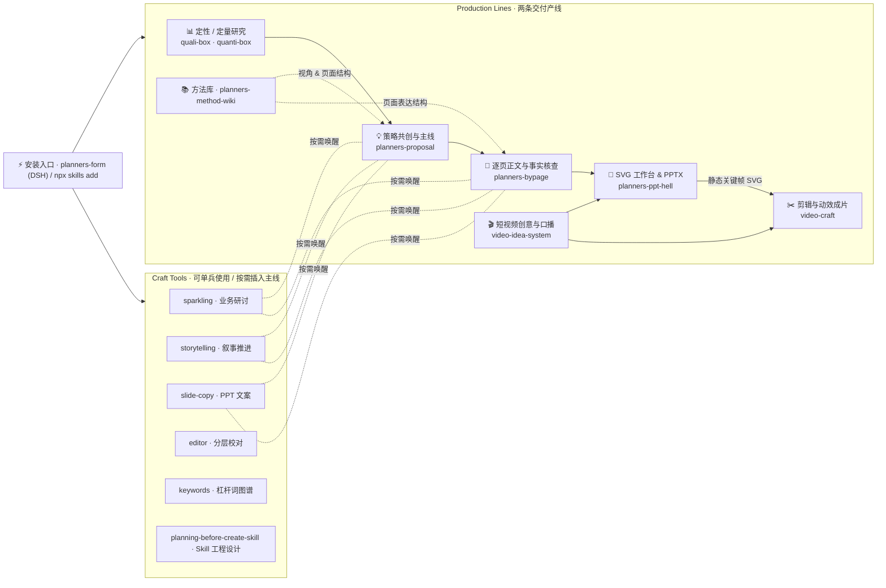

# Planner's Desk

*Everything on a strategist's desk, rebuilt as AI skills.*

我是 **阿祖不看 TVC**（个人站 [demyth.info](https://demyth.info) · 联系 `Lawyif@163.com`）。这是一个围绕**真实策略顾问与内容创作者工作流**打造的开源 AI Skill 集合——既可以把零散调研一步步磨成可交付的 PPT 与视频，也可以拆出单个「手艺工具」独立调用。

---

## 整体怎么协同？

所有仓库按角色分成三层：**`Production Lines`（两条交付产线）**、**`Craft Tools`（可独立调用的手艺工具）** 与 **`Core & Plugins`（公共底座与 DSH 插件）**。



> 按类别快速浏览仓库：[交付产线 (`production-line`)](https://github.com/thePlannerIvan?tab=repositories&q=topic:production-line) · [手艺工具 (`craft-tool`)](https://github.com/thePlannerIvan?tab=repositories&q=topic:craft-tool) · [底座与插件 (`planners-core` / `dsh-plugin`)](https://github.com/thePlannerIvan?tab=repositories&q=topic:planners-desk)

---

## 如何上手与安装（30 秒开始）

### 方式一：DSH 用户（最推荐 · 一键安装整套或按需勾选）

我专门做了一个统一安装入口 **[Planners Form](https://github.com/thePlannerIvan/planners-form)**，不用自己找仓库、配依赖或手动搭审阅面板：

1. 在 DSH 打开 **插件 → 添加插件**，粘贴仓库地址并点击 **安装**：
   ```text
   https://github.com/thePlannerIvan/planners-form
   ```
2. 启用后打开 **设置 → Planners Form**，想用哪个环节就勾选对应 Skill，点击 **安装所选 Skill**（所需的 `planners-review-core`、`planners-source-index`、`planners-fact-check` 等公共底座会自动备齐）。
   *(如遇 GitHub 网络波动，可下载该仓 zip 包用 `dsh plugin --profile <name> add <解压目录>` 本地安装。)*

### 方式二：Codex / Claude Code / Antigravity 用户

挑你今天要用的那个仓库直接安装，共享底座首次运行时会按需自动准备：

```bash
# 按需安装任一 Skill（以 planners-proposal 或独立单兵 sparkling 为例）
npx skills add https://github.com/thePlannerIvan/planners-proposal --skill planners-proposal
npx skills add https://github.com/thePlannerIvan/sparkling --skill sparkling
```

### 装完怎么开口用？（直接复制这三句）

- **从一堆调研资料开始做商业提案 PPT**：
  `使用 $planners-proposal 完整阅读这个目录的 Brief 和调研资料，和我一起收敛策略判断，写成 storyline.md 并打开工作台让我调整。`
- **把定稿主线扩成可编程 PPT 文案并核查数据**：
  `使用 $planners-bypage 读取 .planners/storyline.md，按页面表达结构写成逐页稿 by-page.md，跑完独立事实核查再开工作台审阅。`
- **单独用一个手艺工具拆卡点 / 改文章**：
  `使用 $sparkling 带我用证据对撞拆解下面这份业务材料，最后给出一页纸结论。`

---

## 1. Production Lines · 交付产线

把零散资料一路推向最终交付的端到端流水线。你可以从任意一环切入，但每环产出的契约（`planners-doc/2`、`source-index/2.1.0`、`fact-audit`）都是上下游无缝咬合的。

### A. 商业调研、提案与 PPT 产线

| 阶段 | 仓库 | 它帮你解决什么问题 |
|---|---|---|
| 定性洞察 | [`planners-quali-box`](https://github.com/thePlannerIvan/planners-quali-box) | 把社媒评论、访谈与开放题变成有证据链路和 HTML 报告的洞察结论 |
| 定量决策 | [`planners-quanti-box`](https://github.com/thePlannerIvan/planners-quanti-box) | 让 CSV/Excel 自动产出可回溯的数据检验、驱动拆解与咨询式离线报告 |
| 方法智库 | [`planners-method-wiki`](https://github.com/thePlannerIvan/planners-method-wiki) | **Karpathy LLM Wiki (Markdown 真源)**：自带 11 模块 33 种分析视角与页面表达结构，可编译离线 `wiki-viewer.html` |
| 策略主线 | [`planners-proposal`](https://github.com/thePlannerIvan/planners-proposal) | 消化多源资料、组织高摩擦研讨，在实时文字工作台拖拽磨顺 `storyline.md` |
| 逐页核查 | [`planners-bypage`](https://github.com/thePlannerIvan/planners-bypage) | 把 Storyline 扩写成适合编程 PPT 的逐页稿 `by-page.md`，后台补齐原文底账并过独立 `fact-check` 门禁 |
| 视觉交付 | [`planners-ppt-hell`](https://github.com/thePlannerIvan/planners-ppt-hell) | 基于模板包与构图规则生成可交互 SVG 视觉工作台，多模态看图自检并按需导出可编辑 `.pptx` |

### B. 内容与短视频产线

| 阶段 | 仓库 | 它帮你解决什么问题 |
|---|---|---|
| 创意与口播 | [`video-idea-system`](https://github.com/thePlannerIvan/video-idea-system) | 用 52 张创意卡发散与 Story Battle 定出可录口播稿与画面契约（含念稿审阅页） |
| 画面静帧 | [`planners-ppt-hell`](https://github.com/thePlannerIvan/planners-ppt-hell) | 视频路线下为口播画面输出带风格包与保护守卫的静态关键帧 SVG |
| 剪辑成片 | [`video-craft`](https://github.com/thePlannerIvan/video-craft) | 承接口播、音频与静态 SVG，完成时间轴绑定、轻动效、语义字幕与审阅合成 |

---

## 2. Craft Tools · 手艺工具

不依赖整条流水线、**单装即可直接上手的独立 Skill**（其中 `sparkling`、`storytelling`、`slide-copy` 也是上方产线会自动协同的专精镜头）：

| 工具 | 它帮你解决什么问题 |
|---|---|
| [`sparkling`](https://github.com/thePlannerIvan/sparkling) | **业务研讨**：携材料展开高摩擦结构化研讨，用证据对撞打破旧判断并收敛一页纸结论 |
| [`storytelling`](https://github.com/thePlannerIvan/storytelling) | **叙事引擎**：打破平铺直叙的说明文清单，注入认知张力与章节推进动量 |
| [`slide-copy`](https://github.com/thePlannerIvan/slide-copy) | **PPT 文案规范**：专治页面像散文——训练标题即判断、结构高密度的上屏文案 |
| [`editor`](https://github.com/thePlannerIvan/editor) | **分层校对工作台**：AI 建议以红绿内联标在原文中（点绿同意、点红不改、未点默认接受），全文可直接编辑 |
| [`keywords`](https://github.com/thePlannerIvan/keywords) | **杠杆词图谱**：将陌生专业领域的关键术语梳理为可视化思维导图与一键调用词表 |
| [`planning-before-create-skill`](https://github.com/thePlannerIvan/planning-before-create-skill) | **Skill 工程准则**：用 OKR / Playbook / Deep-module CLI 与确定性 lint/evals 打造真正可靠的 Agent Skill |

---

<details>
<summary><h2>3. Core &amp; Plugins · 公共底座、DSH 插件与生态仓库</h2></summary>

这些仓库为上面的产线和工作台提供统一的交互、来源追踪、事实校验与安装底座（通常随主线自动准备，也可供其他 Skill 作者独立复用）：

| 类型 | 仓库 | 职责说明 |
|---|---|---|
| DSH 插件 | [`planners-form`](https://github.com/thePlannerIvan/planners-form) | DSH 设置页中的统一安装器、依赖准备与版本更新面板 |
| DSH 插件 | [`dsh-review-dock`](https://github.com/thePlannerIvan/dsh-review-dock) | DSH 右侧栏通用审阅宿主，支持挂载所有工作台 HTML 并唤醒 Agent |
| 公共底座 | [`planners-review-core`](https://github.com/thePlannerIvan/planners-review-core) | 统一提供 `planners-doc/2` 实时文字工作台、`doc-surface` / `doc-workbench`、结构 diff 与批注流 |
| 公共底座 | [`planners-source-index`](https://github.com/thePlannerIvan/planners-source-index) | `source-index/2.1.0` 来源台账、可信度等级（`provenance`）与未读盲区校验器 |
| 公共底座 | [`planners-fact-check`](https://github.com/thePlannerIvan/planners-fact-check) | 独立事实核查契约与枚举/门禁校验器（专防数值漂移与口径错配） |
| 公共底座 | [`planners-report-kit`](https://github.com/thePlannerIvan/planners-report-kit) | 单文件离线 HTML 报告统一装配管线与外链依赖拦截器 |
| DSH 生态 | [`DSH-better-sidebar`](https://github.com/thePlannerIvan/DSH-better-sidebar) | 支持三方扩展注册新 Tab、内置渲染/终端/子代理的增强侧边栏 |
| DSH 生态 | [`deepseek-harness`](https://github.com/thePlannerIvan/deepseek-harness) | DeepSeek Harness 插件化底座参考 |

</details>
