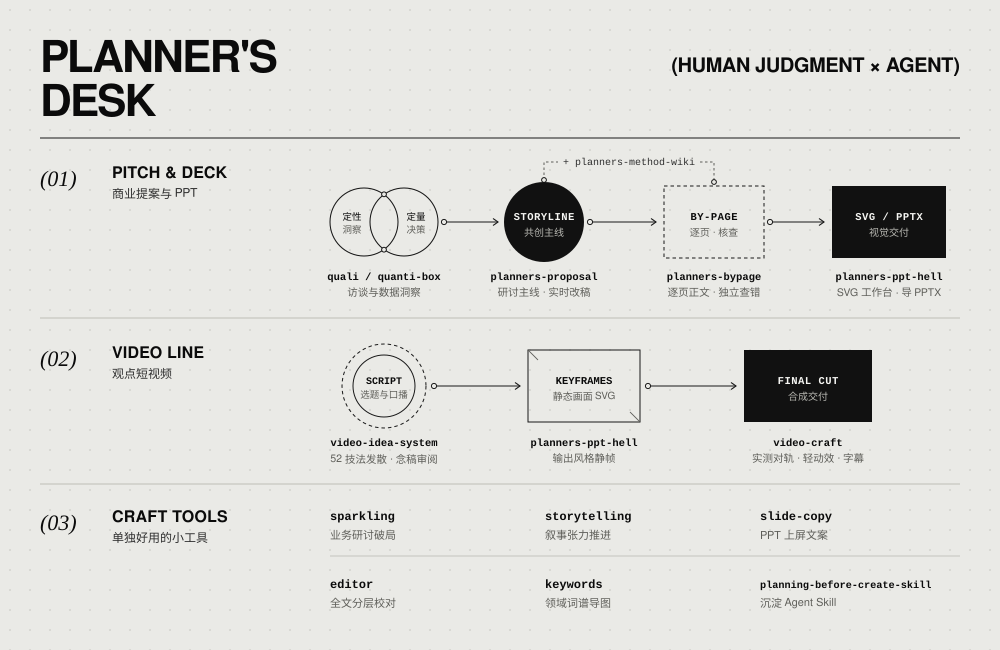

# Planner's Desk

> **人的价值在于判断和创意，那就把收集整理、推演写作、核查与制作交给 Agent——为 Marketer 打造的 AI 效能放大器。**

<br/>

AI 看起来像程序员的专属领域。工程师早已在用 Agent 和工作流重构一切，而做 Marketing 的人，往往还在争论「AI 到底有没有用」。

经过半年的自我颠覆，我越来越笃定一个边界：**AI 想不出真正打动人的 Brilliant Idea，也做不出有锋芒的商业判断和消费者洞察。** 但剩下的绝大多数重体力活：啃完几十份访谈和行业报告、展开高摩擦脑暴、磨顺提案 Storyline、写透可编排的逐页正文、核查每一处数字出处、排成可交付的 PPT，甚至剪成一条口播视频——**全都可以被组织成一套稳定运转的 AI 工作流。**

当重复无聊的工作能交给 AI，人就能迸发出无穷无尽的 Idea，能够被快速验证、落地和交付。

我是**阿祖**，一名品牌策略（小红书同名 · 个人站 [demyth.info](https://demyth.info/) · `Lawyif@163.com`）。我把自己在真实品牌项目里摸索出 AI 边界、打磨出来的人机协作方法，开源整理成 **Planner's Desk**——希望让所有做 Marketing、做品牌、做内容的人，不必从零踩坑，真正放大自己的能力。

---

## 一张图看懂怎么用

你可以从一条已成型的**工作流（`01` / `02`）**直接开跑，也可以只抽下面六把**单独好用的小工具（`03`）**立刻上手。

<p align="center">
  <picture>
    <source media="(prefers-color-scheme: dark)" srcset="./assets/planners-desk-dark.svg" />
    <source media="(prefers-color-scheme: light)" srcset="./assets/planners-desk-light.svg" />
    
  </picture>
</p>

> 按类别直达仓库：[成型工作流 (`production-line`)](https://github.com/thePlannerIvan?tab=repositories&q=topic:production-line) · [单兵手艺工具 (`craft-tool`)](https://github.com/thePlannerIvan?tab=repositories&q=topic:craft-tool) · [全部套件 (`planners-desk`)](https://github.com/thePlannerIvan?tab=repositories&q=topic:planners-desk)

---

## 30 秒安装上手

你不需要研究下面这些仓库之间复杂的依赖关系，两条路都能直接开跑：

### 方式一：DSH 用户（最推荐 · 一键装好整套或按需勾选）

我专门做了一个统一安装器 **[Planners Form](https://github.com/thePlannerIvan/planners-form)**，装完它就能在界面里点选任意环节，所有配套底座和审阅面板会自动配齐：

1. 打开 DSH → **插件 → 添加插件**，粘贴下面地址并点 **安装**：
   ```text
   https://github.com/thePlannerIvan/planners-form
   ```
2. 启用后打开 **设置 → Planners Form**，需要写方案、做图还是剪视频，直接勾选并点 **安装所选 Skill**。
   *(若直连 GitHub 超时，可下载仓库 zip 包并用 `dsh plugin --profile <name> add <解压目录>` 本地安装。)*

### 方式二：Codex / Claude Code / Antigravity 用户

挑你此刻最想试的单个仓库安装即可（共享底座在首次运行时按需自动备齐）：

```bash
# 例：装整套策略主线，或只装一把单独好用的手艺工具
npx skills add https://github.com/thePlannerIvan/planners-proposal --skill planners-proposal
npx skills add https://github.com/thePlannerIvan/sparkling --skill sparkling
```

### 装完怎么对 AI 开口？（直接复制这几句）

- **手里有一堆调研资料，想理出策略主线**：
  > `使用 $planners-proposal 完整阅读这个目录的 Brief 和调研资料，和我一起收敛策略判断，写成 storyline.md 并打开工作台让我调整。`
- **主线定好了，要写成可做 PPT 的逐页正文并严查数据**：
  > `使用 $planners-bypage 读取 .planners/storyline.md，按页面表达结构写成逐页稿 by-page.md，跑完独立事实核查后再开工作台审阅。`
- **只想找 AI 陪我拆一个业务卡点 / 顺一篇长稿**：
  > `使用 $sparkling 带我用证据对撞拆解这份业务材料，给出一页纸战略结论。`

---

## 1. Production Lines · 已成型的端到端工作流

每一环都对应真实的策略顾问工作阶段——从任意一环切入都能跑通，上一环交出的文件，下一环会直接认领并继续推进。

### 商业调研、提案与 PPT 产线

| 阶段 | 仓库 | 替你接管什么工作 |
|---|---|---|
| **01 · 拆透资料** | [`planners-quali-box`](https://github.com/thePlannerIvan/planners-quali-box) · [`planners-quanti-box`](https://github.com/thePlannerIvan/planners-quanti-box) | 分别消化社媒评论/访谈与 CSV/Excel 表格，自动输出溯源清楚的研究结论与离线 HTML 报告 |
| **02 · 共创主线** | [`planners-proposal`](https://github.com/thePlannerIvan/planners-proposal) | 消化 Brief 与调研材料、多轮对齐取舍，生成可在实时工作台拖拽改字的 `storyline.md` |
| **方法智库（随时查）** | [`planners-method-wiki`](https://github.com/thePlannerIvan/planners-method-wiki) | Karpathy Markdown 方法库：自带 11 个营销模块、33 种分析视角与页面表达结构（含离线 `wiki-viewer.html`） |
| **03 · 写透核准** | [`planners-bypage`](https://github.com/thePlannerIvan/planners-bypage) | 结合页面结构把 Storyline 扩写成适合编程 PPT 的 `by-page.md`，自动抽原文底账并通过独立事实核查 |
| **04 · 视觉交付** | [`planners-ppt-hell`](https://github.com/thePlannerIvan/planners-ppt-hell) | 用设计模板包与版式原语做高密咨询页 SVG 视觉工作台，支持多模态看图自检与按需导出 `.pptx` |

### 观点短视频产线

| 阶段 | 仓库 | 替你接管什么工作 |
|---|---|---|
| **01 · 创意与口播** | [`video-idea-system`](https://github.com/thePlannerIvan/video-idea-system) | 用 52 技法发散与 Story Battle 磨出观点，交付带念稿审阅面的可录口播稿与画面契约 |
| **02 · 静态关键帧** | [`planners-ppt-hell`](https://github.com/thePlannerIvan/planners-ppt-hell) | 在视频路线上按画面契约输出风格统一的静态关键帧 SVG |
| **03 · 剪辑成片** | [`video-craft`](https://github.com/thePlannerIvan/video-craft) | 承接口播录音与静态 SVG，完成实测时间轴对齐、轻动效、语义字幕与审阅合成 |

---

## 2. Craft Tools · 随时可单拔的手艺小工具

不用开整套工程、随时拉一个起来就能帮具体活提速（其中前三项在跑上面产线时也会被自动唤醒协同）：

| 工具 | 什么时候拉它出来 |
|---|---|
| [`sparkling`](https://github.com/thePlannerIvan/sparkling) | 带着材料讨论卡点、需要用证据对撞打破旧判断，收敛成一页纸结论时 |
| [`storytelling`](https://github.com/thePlannerIvan/storytelling) | 写出来的方案或文章全是干巴巴的事实罗列，需要注入认知引力与推进动量时 |
| [`slide-copy`](https://github.com/thePlannerIvan/slide-copy) | PPT 总是写成大段散文，需要写出标题即判断、结构高密度上屏文案时 |
| [`editor`](https://github.com/thePlannerIvan/editor) | 一篇文章写完了需要逐句精校——红绿内联建议，点绿改、点红留、全文直改 |
| [`keywords`](https://github.com/thePlannerIvan/keywords) | 刚切入一个陌生行业或专业领域，想快速建一张带可视化释义的杠杆词图谱时 |
| [`planning-before-create-skill`](https://github.com/thePlannerIvan/planning-before-create-skill) | 想把自己反复在做的某套工作方法，从一次性 Prompt 沉淀成可靠的 Agent Skill 时 |

---

<details>
<summary><h2>3. Core &amp; Plugins · 幕后公共底座与 DSH 插件（日常使用无需手装）</h2></summary>

这些仓库不直接面向最终任务提问，但保证了整张案台的数据可溯源、页面能拖拽、数字不出错、安装不折腾：

| 类型 | 仓库 | 作用 |
|---|---|---|
| DSH 插件 | [`planners-form`](https://github.com/thePlannerIvan/planners-form) | 设置页一键勾选安装套件 Skill 与更新管理 |
| DSH 插件 | [`dsh-review-dock`](https://github.com/thePlannerIvan/dsh-review-dock) | DSH 侧栏通用审阅宿主（挂载所有文字 / 视觉工作台并唤醒改稿） |
| 公共底座 | [`planners-review-core`](https://github.com/thePlannerIvan/planners-review-core) | 统一文字工作台（`planners-doc/2`）、结构 diff、块级 patch 与历史版本 |
| 公共底座 | [`planners-source-index`](https://github.com/thePlannerIvan/planners-source-index) | 来源路径、可信度等级（`provenance`）与未读盲区账本契约 |
| 公共底座 | [`planners-fact-check`](https://github.com/thePlannerIvan/planners-fact-check) | 独立事实核查底座：专抓数字漂移、算错与主体时间错配 |
| 公共底座 | [`planners-report-kit`](https://github.com/thePlannerIvan/planners-report-kit) | 单文件离线 HTML 报告装配管线与外链依赖拦截 |
| DSH 生态 | [`DSH-better-sidebar`](https://github.com/thePlannerIvan/DSH-better-sidebar) · [`deepseek-harness`](https://github.com/thePlannerIvan/deepseek-harness) | DSH 增强侧栏工作台与插件化底座参考 |

</details>
